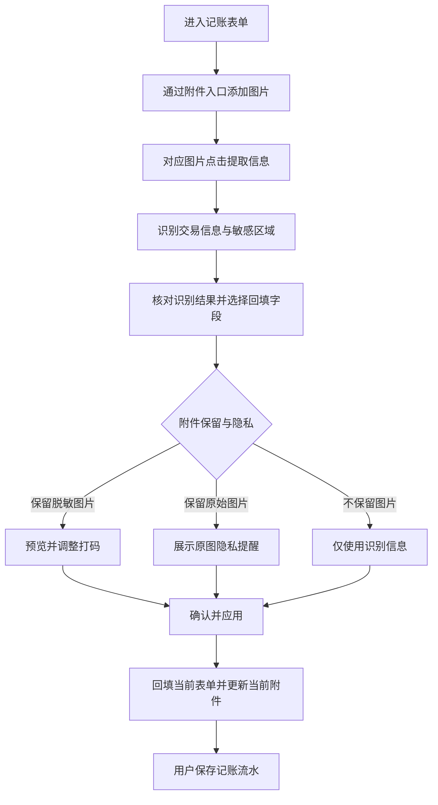

# 记账附件与订单截图识别交互设计方案

> 适用范围：电脑端、手机端新增及编辑日常收支流水
> 文档状态：2026-11-26 按方案实施；订单号／物流号已确认新增普通流水字段。现行行为见[操作指南](../guides/attachment-capture.md)。
> 核心原则：以附件为图片统一入口，一次添加、按图处理、核对回填、按需保留。

## 1. 设计目标

在保持现有记账表单结构的前提下，优化订单截图识别和附件隐私处理体验。

- 移除描述区域下方原有的「从截图识别金额与日期」独立入口。
- 用户通过现有附件入口添加图片，在对应图片上点击「提取信息」，无需重复选择图片。
- 识别结果先核对、后回填，默认保护用户已有手填值。
- 将隐私打码和图片保留方式整合为「附件保留与隐私」下拉框及其联动设置。
- 支持保留脱敏图片、保留原始图片、不保留图片三种方式。
- 订单号、物流号按正常业务规则保存，不设置独立的「本机留存」模块、开关或额外确认。
- 电脑端与手机端共用处理逻辑，仅调整页面布局和操作方式。

## 2. 整体交互流程



「确认并应用」仅更新当前记账表单及其附件草稿，不等于保存流水。用户仍通过原有「保存」或「保存并继续」完成记账。

## 3. 电脑端设计

### 3.1 弹窗结构

- 默认宽度：880px。
- 最大高度：屏幕高度的 90%（90vh）。
- 标题栏和底部操作栏固定，中间内容纵向滚动。
- 保留原有常用 / 完整模式、草稿、更多字段、校验及保存机制。

```text
记账弹窗：新增 · 日常收支
├─ 顶部标题栏
│  ├─ 标题：新增 · 日常收支
│  ├─ 字段显示模式：常用 | 完整
│  └─ 关闭按钮
├─ 草稿提示区（有草稿时显示）
│  ├─ 有未完成草稿
│  ├─ 恢复草稿
│  └─ 重新开始
├─ 基础信息
│  ├─ 类型                     收付款账户
│  ├─ 金额（通栏，附带币种名称）
│  └─ 分类（通栏）
│     └─ 自动预选原因
├─ 交易详情
│  ├─ 日期                     交易时间
│  ├─ 描述（通栏）
│  └─ 附件 / 图片（通栏，紧接描述下方）
│     ├─ 添加文件              拍照
│     ├─ 支持拖拽、粘贴截图
│     └─ 已添加附件列表
│        └─ 单个附件
│           ├─ 缩略图（点击预览）
│           ├─ 文件名、大小、处理状态
│           ├─ 提取信息（图片附件）
│           ├─ 保存到本机
│           ├─ 移除
│           └─ 附件处理面板（按需展开）
├─ 更多字段（常用模式下可展开）
│  ├─ 币种、交易时区
│  ├─ 交易对象 / 商家、地点、标签、备注
│  └─ 按业务条件出现的字段
│     ├─ 成本核算币种、价值及确认
│     ├─ 转账相关信息
│     └─ 退款关联及分配信息
├─ 状态与校验提示
│  ├─ 草稿自动保存状态
│  ├─ 保存错误、字段错误
│  └─ 沿用常用字段（支持连续记账时）
└─ 底部操作栏
   ├─ 删除 / 作废（编辑时，按入口提供）
   ├─ 取消
   ├─ 保存并继续（支持该操作的入口）
   └─ 保存
```

### 3.2 单个附件卡片

```text
附件 / 图片
[＋ 添加文件]  [拍照]

┌──────────────────────────────────────────────────────────┐
│ [缩略图]  订单截图.png                    [保存到本机] [移除] │
│          328 KB · 尚未提取信息               [提取信息]    │
└──────────────────────────────────────────────────────────┘
```

- 图片附件显示「提取信息」按钮，普通非图片附件继续使用原有操作。
- 点击缩略图进入图片预览，点击「提取信息」直接处理当前图片。
- 不打开新的文件选择器，不要求重新上传。
- 识别完成后在当前附件下方展开面板；建议同一时间仅展开一张图片的处理面板。

### 3.3 附件处理面板

```text
┌─ 订单截图.png · 已提取信息 ────────────────────────────┐
│ 信息核对                                               │
│ ☑ 实付金额        ¥68.50                               │
│ ☑ 交易日期        2026-11-25                           │
│ ☑ 交易时间        18:42                                │
│ ☑ 交易对象        某某生活超市                         │
│ ☐ 描述            纸巾、洗衣液等商品                   │
│   已有手填内容：家庭日用品（默认保留）                  │
│                                                        │
│ 附件保留与隐私                                         │
│ [保留脱敏图片（推荐）                              ▾] │
│                                                        │
│ 原图 | 脱敏预览         隐私打码             [全选]   │
│ ┌───────────────────┐  ☑ 收货人                       │
│ │     订单详情      │  ☑ 手机号                       │
│ │      ¥68.50       │  ☑ 收货地址                     │
│ │  收货人  ██████   │  ☑ 订单号                       │
│ │  手机号  ██████   │  ☑ 物流号                       │
│ │  地址    ██████   │                                 │
│ │  订单号  ██████   │  [手动调整打码区域]             │
│ │  物流号  ██████   │                                 │
│ └───────────────────┘                                 │
│ 已打码 5 处                                            │
│                                                        │
│ 保留脱敏图片 · 打码 5 处        [暂不处理] [确认并应用] │
└────────────────────────────────────────────────────────┘
```

说明：上图为选中「保留脱敏图片」时的状态。核对区按字段显示识别值、当前值和回填选项；图片预览和打码配置采用左右布局，空间不足时可上下排列。建议预览和设置区域宽度约为 40% : 60%，以实际组件宽度为准。

## 4. 手机端设计

### 4.1 页面组织

采用「原记账页面 + 全屏附件处理子页」，不在小屏幕内叠加多个弹窗，也不改变原有记账表单结构。

```text
┌──────────────────────────┐
│ ×   新增 · 日常收支  常用 ▾│
├──────────────────────────┤
│ 类型           账户       │
│ [支出 ▾]       [支付宝 ▾] │
│ 金额                      │
│ [0.00              CNY]  │
│ 分类                      │
│ [生活用品             ▾] │
│ 日期           交易时间   │
│ [2026-11-26]   [12:30]   │
│ 描述                      │
│ [家庭日用品]              │
│ 附件 / 图片               │
│ ┌──────────────────────┐ │
│ │ [图] 订单截图.png  ···│ │
│ │      328 KB · 未提取  │ │
│ │      [提取信息]      │ │
│ └──────────────────────┘ │
│ [添加图片]     [拍照]    │
│ 更多字段              ▾  │
├──────────────────────────┤
│ 草稿       [取消] [保存] │
└──────────────────────────┘
```

点击「提取信息」进入当前图片的处理子页。进入子页时保留原记账表单及其滚动位置、输入值和草稿状态。

### 4.2 附件处理子页

```text
┌──────────────────────────┐
│ ‹    附件处理             │
│      订单截图.png         │
├──────────────────────────┤
│ 图片预览                  │
│ ┌──────────────────────┐ │
│ │      订单详情        │ │
│ │       ¥68.50         │ │
│ │  收货人      █████   │ │
│ │  手机号      █████   │ │
│ │  收货地址    █████   │ │
│ │  订单号      █████   │ │
│ │  物流号      █████   │ │
│ └──────────────────────┘ │
│ [原图]    [脱敏预览]     │
│                          │
│ 信息核对       已选 4 项 │
│ ☑ 实付金额        ¥68.50 │
│ ☑ 交易日期    2026-11-25 │
│ ☑ 交易时间         18:42 │
│ ☑ 商家       某某生活超市│
│ ☐ 描述       纸巾、洗衣液│
│   保留已有：家庭日用品   │
│                          │
│ 附件保留与隐私           │
│ [保留脱敏图片（推荐） ▾] │
│ ┌──────────────────────┐ │
│ │ 隐私打码      5 处  ▾│ │
│ │ ☑ 收货人             │ │
│ │ ☑ 手机号             │ │
│ │ ☑ 收货地址           │ │
│ │ ☑ 订单号             │ │
│ │ ☑ 物流号             │ │
│ │ [手动调整打码区域]   │ │
│ └──────────────────────┘ │
├──────────────────────────┤
│       [确认并应用]       │
└──────────────────────────┘
```

- 图片、信息核对、保留方式、隐私设置按顺序纵向排列。
- 图片预览默认高度建议为 200～240px，支持点击放大；手动打码采用全屏图片编辑，支持缩放及拖动。
- 隐私打码区域可折叠，折叠时显示打码数量；原型中默认展开，便于核对。
- 「附件保留与隐私」仍为下拉框，可使用移动端原生选择器，不改为多张选项卡片。
- 底部固定「确认并应用」按钮，适配安全区；内容区域独立滚动。
- 点击确认后直接返回原记账页面，更新表单及附件状态。
- 点击返回而未确认时不应用修改；若有未提交的调整，可提示放弃或继续编辑。

### 4.3 电脑端与手机端对照

| 项目 | 电脑端 | 手机端 |
| --- | --- | --- |
| 记账容器 | 880px 弹窗，最大高度 90vh | 原记账页面 |
| 附件入口 | 附件卡片上的提取信息 | 附件卡片上的提取信息 |
| 处理界面 | 当前附件下方展开 | 全屏处理子页 |
| 预览与打码 | 左右分栏 | 上下排列，可折叠 |
| 保留方式 | 下拉框 | 下拉框 / 原生选择器 |
| 手动打码 | 图片编辑区域 | 全屏图片编辑 |
| 确认操作 | 面板底部 | 屏幕底部固定 |
| 处理完成 | 更新当前附件及表单 | 返回原表单并更新 |

## 5. 附件保留与隐私（统一规则）

### 5.1 下拉框

字段名称：**附件保留与隐私**

```text
[保留脱敏图片（推荐） ▾]
 ├─ 保留脱敏图片（推荐）
 ├─ 保留原始图片
 └─ 不保留图片
```

默认选中「保留脱敏图片（推荐）」。该默认值适用于进入附件识别处理流程，不改变未主动处理的普通附件原有保存逻辑。

| 选择 | 图片预览 | 打码配置 | 确认后的附件结果 |
| --- | --- | --- | --- |
| 保留脱敏图片（推荐） | 原图 / 脱敏预览可切换 | 显示 | 脱敏图片替换当前附件 |
| 保留原始图片 | 原图 | 隐藏 | 保留当前原图 |
| 不保留图片 | 可用于核对的原图 | 隐藏 | 移除当前附件，仅保留业务信息 |

切换下拉选项仅调整待应用方案，不立即删除或替换附件。当前未提交的打码配置可以在本次处理会话内保留，切换回脱敏模式时恢复。

### 5.2 隐私打码

仅在「保留脱敏图片」模式下显示打码设置。

默认勾选所有已检测到的敏感区域，包括但不限于：

- 收货人姓名；
- 手机号；
- 收货地址；
- 订单号；
- 物流号；
- 其他实际检测到的敏感信息，例如身份证号、支付账号、二维码、条形码。

支持取消单项勾选、全选 / 取消全选、恢复默认打码及手动框选、移动、调整和删除打码区域。复选框与脱敏预览实时联动。

金额、商家、商品名称和交易时间原则上保留可见，用户仍可根据需要手动遮盖。若存在未打码的已识别敏感区域，显示简短提醒；若取消全部打码，应明确提示当前图片实际未脱敏，不能将其标记为已脱敏。

保留原图时，仅显示简短提示：「保留原始截图，不进行隐私打码。」

不保留图片时，仅显示：「回填信息后移除当前图片附件。」

### 5.3 订单号、物流号处理

**不设置本机留存选项。**

订单号、物流号属于正常业务信息，按现有业务数据规则进行识别、校验、保存、同步和导出（如相关功能支持），不因为附件保留方式或图片是否打码而改变其业务保存规则。

- 图片上的订单号和物流号打码，仅影响保存后图片的可见内容。
- 不在隐私区重复展示掩码编号，不设置独立的编号保存复选框、表格列、开关或说明模块。
- 若用户选择不保留图片，已确认的有效业务数据仍按正常规则保存。
- 若现有系统尚无相应业务字段，开发前应确认数据模型和映射，不能擅自将编号拼入描述或备注，也不能在界面宣称已保存实际未持久化的数据。

## 6. 信息识别、核对和回填

### 6.1 识别范围

| 信息 | 目标字段 / 用途 |
| --- | --- |
| 实付金额 | 金额 |
| 交易日期 | 日期 |
| 交易时间 | 交易时间 |
| 商家 | 交易对象 / 商家 |
| 商品摘要 | 描述（可选回填） |
| 币种（明确可识别时） | 币种，需校验账户与金额含义 |
| 订单号、物流号 | 按现有业务数据规则映射 |
| 敏感内容及位置 | 生成隐私打码建议 |

不将订单原价、优惠金额、运费或订单总额误当实付金额；存在多个候选金额或日期时，应提示核对，不自动选取不确定值。无法可靠识别的字段不填写、不编造。

沿用原有本机识别原则：原图用于本机处理，识别本身不主动上传原图。若实现方案无法满足本机识别，需另行明确数据处理方式，不得将远程识别描述为本机识别。

### 6.2 回填保护

识别结果必须经用户确认后才写入当前记账表单。

| 当前字段状态 | 默认行为 |
| --- | --- |
| 未填写 | 高可信识别结果默认勾选回填 |
| 系统默认值 | 高可信识别结果可默认勾选 |
| 系统自动预选值 | 可按规则更新，展示原因 |
| 用户手动填写 | 默认不勾选，保留当前值 |
| 用户主动清空 | 视为手动修改，不自动填入 |
| 已由其他图片回填 | 默认保留，展示差异 |
| 与识别结果一致 | 标记一致，无需重复写入 |
| 识别不确定 | 默认不勾选，提示核对 |

需要覆盖已有值时，显示当前值和识别值，由用户主动选择。字段来源及修改版本应作为保护依据，不能只根据是否为空判断。

若用户在异步识别过程中修改了字段，确认应用时重新校验字段最新状态；出现冲突时保留最新手填值，重新请用户核对。建议提供一次「撤销本次回填」，仅撤销本次实际写入且之后未被用户修改的字段。

## 7. 附件状态与操作

| 状态 | 展示文案示例 | 可用操作 |
| --- | --- | --- |
| 未处理 | 尚未提取信息 | 提取信息、预览、保存到本机、移除 |
| 识别中 | 正在识别图片 | 取消识别 |
| 待核对 | 已识别 5 项信息 | 核对信息、取消处理 |
| 已脱敏 | 已打码 5 处 · 信息已回填 | 查看结果、预览、保存到本机、移除 |
| 保留原图 | 保留原图 · 信息已回填 | 查看结果、预览、保存到本机、移除 |
| 不保留图片 | 已提取信息，不保留图片 | 返回表单，不再显示该附件 |
| 识别失败 | 未找到有效交易信息 | 重新提取、手动隐私处理、保留或移除图片 |

「信息已回填」应以实际确认并应用的字段为准。若未选任何字段而仅进行了打码，则显示相应附件处理状态，不显示虚假的回填结果。

识别状态、图片保留状态和打码状态应分别记录，避免将识别失败等同于附件不可使用。

## 8. 文件保存与隐私处理规则

### 8.1 文件处理

- 确认保留脱敏图片时，将打码实际写入输出图片像素，不使用仅界面可见的遮罩层替代真实打码。
- 脱敏附件应清除不必要的 EXIF 等元数据，并确保缩略图、预览、下载和后续附件同步均使用同一脱敏版本。
- 脱敏文件替换当前附件，不自动增加一份重复附件；可使用 `订单截图_脱敏.png` 等文件名。
- 不将原图作为脱敏附件的隐藏副本保存或同步。处理所需原图可在未提交的草稿阶段临时使用，在不再需要且安全提交后释放临时引用；不得删除用户设备上原有的源文件。
- 保留原图时继续使用原附件及既有存储规则；不保留图片时移除该附件的草稿引用，不影响已经确认的记账信息。
- 选择保存脱敏图片但生成失败时，应保留待处理状态并允许重试，不得静默退回保存原图。

### 8.2 保存到本机（原有附件下载功能）

此操作是文件下载，与已取消的编号「本机留存」概念无关。

| 当前附件状态 | 下载行为 |
| --- | --- |
| 未处理 / 保留原图 | 保存当前原图 |
| 已脱敏 | 默认保存已脱敏附件 |
| 不保留图片 | 应用后无该附件，不再显示下载按钮 |

对于仍处于处理中的图片，如后续需要支持临时导出脱敏预览，必须实际生成脱敏文件再导出，不能误下载原图。该扩展不是本版必需功能。

## 9. 与现有记账功能的兼容

| 功能 | 处理规则 |
| --- | --- |
| 常用 / 完整模式 | 两种模式均显示附件入口 |
| 更多字段 | 商家等可回填至原字段，不强制展开全部区域 |
| 草稿自动保存 | 保留已确认的表单与附件处理结果；未确认的原图及识别结果不随云端草稿自动上传 |
| 恢复草稿 | 恢复已确认数据及可用附件；临时文件不可用时明确提示 |
| 取消附件处理 | 不改变表单和当前附件，未提交处理结果不生效 |
| 取消记账 | 继续遵循原有草稿或放弃规则 |
| 移除附件 | 不自动清空已经确认回填的业务字段 |
| 保存失败 | 保留当前草稿与处理结果，支持重试 |
| 保存并继续 | 保留原有日期、账户、币种、分类沿用逻辑；金额、描述重新填写；不继承图片、识别结果及上一笔订单业务数据 |
| 编辑已有流水 | 支持对已有图片重新提取或隐私处理；已删除或被替换的原图不保证可恢复 |

主表单保存时若存在尚未确认的附件处理结果，提示先应用或放弃该次处理。未主动进行识别的普通附件不因此被禁止保存，仍遵循既有附件权限及隐私规则。

## 10. 实现建议

以下为逻辑层建议，不规定具体框架、数据库字段名称或 API 结构。

- 以稳定的附件 ID 关联当前图片、识别结果、打码区域和待应用方案，避免不同附件之间串用数据。
- 打码区域使用原始图片坐标或归一化坐标记录，预览缩放不能影响最终输出位置。
- 识别任务可取消；附件被移除或替换后，迟到的异步结果不得回写失效附件。
- 确认应用前校验回填字段版本、金额等业务约束以及图片处理结果；表单与附件的草稿更新应保持一致，失败时可安全重试。
- 同一份已确认处理逻辑供电脑端与手机端复用。
- 在 UI 中不得出现额外的「本机留存」「编号仅在本机保留」等设置。

## 11. 验收标准

- [ ] 描述区域不存在独立的截图识别入口。
- [ ] 添加图片后，当前图片旁出现「提取信息」，点击无需重新选择文件。
- [ ] 普通非图片附件保持原有交互。
- [ ] OCR 结果经核对后才回填，已有手填值默认不被覆盖，异步修改冲突得到保护。
- [ ] 「附件保留与隐私」是下拉框，且只有三个约定选项，默认保留脱敏图片。
- [ ] 选择脱敏模式才显示打码配置，复选框与预览实时联动。
- [ ] 支持手动调整打码区域；最终输出像素真实遮盖，元数据及缩略图无原图隐私残留。
- [ ] 保留脱敏图片时替换当前附件，不生成重复附件；下载默认获得脱敏版本。
- [ ] 保留原图时隐藏打码配置并提示隐私风险。
- [ ] 不保留图片时移除该附件，已确认业务数据正常保存。
- [ ] 不出现任何独立的订单号 / 物流号本机留存设置，编号遵循正常业务规则。
- [ ] 电脑端在原附件下展开处理面板，手机端进入全屏子页并在应用后返回原表单。
- [ ] 手机端底部确认按钮固定，表单值和草稿状态不丢失。
- [ ] 识别失败、取消、图片生成失败及保存失败均有可恢复路径，不影响正常手工记账。
- [ ] 保存并继续不继承上一笔的图片、识别结果及订单业务数据。

## 12. 范围与待确认事项

本方案为最终交互设计文档，尚未修改应用代码。示例订单、金额及日期均为模拟数据。

已确认：图片统一入口、三项下拉保留方式、取消编号本机留存设置、电脑端内联面板、手机端全屏子页。

设计建议（非用户指定的硬性规格）：预览高度 200～240px、电脑端分栏比例约 40% : 60%、单附件展开、拖拽粘贴及撤销回填。

开发前需结合实际 OCR 能力、订单号与物流号字段模型、附件存储、同步和草稿机制确认技术实现。若现有业务模型或本机识别能力不支持相关要求，需明确实现缺口，不能以模拟效果代替正式功能。
