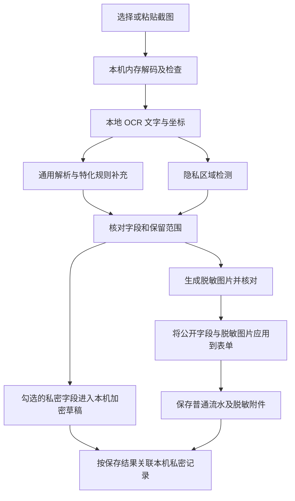

# 全本地订单识别与智能分类方案

状态更新（2026-11-26）：附件入口、三项保留方式、取消独立本机号码 UI 及业务号码同步，以[附件交互方案](attachment-interaction-design.md)和[现行操作指南](../guides/attachment-capture.md)为准。下文为早期分阶段设计，其私密号码保存和强制脱敏条款已被新方案替代，不作为现行验收依据。

历史状态：2026-11-24 已实施情境默认分类、按需本机 OCR、通用解析基础，以及日常收支新图片的隐私核对、实色脱敏附件和订单号／物流号的可选本机加密保留，操作见[智能预选分类](../guides/smart-category-defaults.md)与[本机截图识别](../guides/local-order-ocr.md)。原图与完整文字只留当前任务内存；私密号码使用独立数据库，不进入账本、同步或本应用备份。已覆盖保存意图、失败重试、解锁恢复、锁定清理、作废隐藏和本机清理。内容分类、多图合并订单字段、收件信息保留、设备默认保留预设、真实平台样本集与原生壳性能验收仍待实施。淘宝／京东是优先验证样本，不是通用解析适用边界。下文保留完整设计目标，不代表所有后续能力已交付。

## 1. 产品决策

先优化打开记账时的默认值：无须输入描述，中午 12 点新建支出即可预选“外卖”，有足够历史后按个人同时段习惯选择。截图识别接入同一记账流程，在设备上识别文字、提取字段、根据实际内容修正尚未手选的暂定分类并遮盖隐私，用户核对后保存。订单号、物流单号和收件信息允许选择仅在本机保存；可同步附件必须使用经过用户核对的脱敏副本。

第一期采用 PaddleOCR.js 的 PP-OCRv5 mobile 检测与识别模型，配合通用字段解析器、平台／场景特化规则、时段默认策略和本账本历史匹配。分类区分“打开表单的情境默认”和“有输入后的内容判断”，不把两者塞进同一个固定排序。暂不引入本地生成式大语言模型，也不增加云端识别、分类、物流查询、在线商品查询或自动训练服务。

识别功能与既有账本同步分开：识别全本地运行，用户确认的普通流水和脱敏附件仍可按现有配置同步。服务器托管账本密钥，具有解密能力；敏感信息的保护依靠不进入同步数据，不能依靠“附件已加密”替代脱敏。

### 首期范围

| 纳入首期 | 后续扩展 |
| --- | --- |
| 通用金额／日期／订单／物流等字段解析，淘宝／京东优先验收 | 其他平台／场景的增强规则与验收覆盖扩展 |
| 一笔订单多张截图，用户明确补充到同一草稿 | 多个订单的批量队列和自动拆单 |
| 商品、店铺、实付款、支付状态、付款日期提取 | 复杂分期、组合支付和自动退款匹配 |
| 订单号、多个包裹及收件信息的本机可选保存 | 私密字段跨设备传送与专门备份 |
| 自动遮盖与人工框选；脱敏截图作为附件 | PDF 多页识别、手写收据与发票专门解析 |
| 打开记账即预选分类；描述输入、截图商品在此基础上调整暂定值 | 本地语义嵌入模型、多商品金额分类拆分 |

多商品订单首期生成一笔总支出，可编辑摘要和分类；不按商品标价分摊优惠后金额，不自动创建物品资产。退款截图可以读取并提示状态，但不作为新增普通支出；登记退款进入现有退款关联流程。

## 2. 已有实现及接入位置

| 当前实现 | 复用方式与必要调整 |
| --- | --- |
| `apps/web/src/forms.tsx` 的完整收支表单 | 已接入默认策略、截图识别、金额／日期／时间核对、脱敏图片附件和独立本机号码保留；商品／商家内容应用待实施 |
| `apps/web/src/ui/EntityFormModal.tsx` | 复用字段显示模式、文件数及大小限制、预览和拍照；原图必须先经过订单输入控制器，不能直接进入 `readFiles` 的普通附件草稿 |
| `apps/web/src/ui/QuickExpenseModal.tsx` | 已提取共享策略、午间优先外卖及全范围历史聚合；当前收支页统一使用完整表单，该组件保留兼容；内容判断与截图入口待实施 |
| `apps/web/src/ui/EntityFormModal.tsx` 的 `CategoryPicker` | 默认预选与手选均使用现有合法二级分类，标记值的来源并保护手选；完整分类选择继续复用该组件 |
| `apps/web/src/ui/PayeePicker.tsx`、`payee-recording.ts` | 复用名称／别名匹配及保存时创建交易对象的事务；识别过程不创建商家 |
| `apps/web/src/screens/Transactions.tsx` 的保存流程 | 已复用流水审计事务、附件准备与补偿；新图片准备前检查脱敏摘要和核对版本，私密 pending／linked 在独立数据库处理 |
| `apps/web/src/db/form-drafts.ts` | 普通草稿已有值和文件持久化；仅接收公开字段与脱敏文件，禁止原图和原始 OCR 文本进入该通道 |
| `apps/web/src/db/attachment-storage.ts` | 继续存储脱敏图片及从其生成的缩略图；原图不能成为普通附件对象、暂存对象或同步对象 |
| `apps/web/src/device-storage-key.ts`、`account-storage.ts` | 复用设备解锁与账号隔离，增加独立、加密的本机订单私密存储 |
| `apps/web/src/db/portable-backup.ts`、`backups.ts` | 普通账本导出、设备恢复备份及远程备份均不得包含新增私密存储 |
| `apps/web/offline-build.ts`、`offline-worker.js` | 已将 OCR 大资源分离为带哈希的按需缓存，普通应用安装不预下载模型或推理 Worker |

设计沿用 `apps/web/DESIGN.md` 的文献纸、文楷、墨线与朱色操作。此功能属于完成任务的表单，不新增视觉主题、底部导航项或独立智能助手页面。

## 3. 用户流程和页面

### 3.1 打开记账即预选分类

首要体验是用户打开新的支出表单时分类已经选好，无须先输入描述或再点推荐按钮。例如中午 12 点打开“记一笔”，默认显示“餐饮 → 外卖”，用户通常只需填写金额。默认字段旁使用低干扰文字“按午间时段预选”或“按你近 60 天午间习惯预选”，允许直接点分类修改。

| 场景 | 预期行为 |
| --- | --- |
| 12:00 新建支出，无历史且外卖可用 | 直接预选“外卖”，不先落到其他支出 |
| 12:00 新建支出，近期同类日午间稳定记录食堂／工作餐 | 优先预选个人习惯分类 |
| 打开已有流水、恢复草稿、从模板记账 | 保留已有明确分类，时段策略不覆盖 |
| 用户手动选了交通，表单开到中午 | 始终保留交通，不因时间或后台查询变化跳回外卖 |
| 默认外卖后输入“地铁”且未手选分类 | 明确内容可更新暂定默认为交通相关分类，并说明理由 |
| 12:00 补记昨晚消费并提供昨晚时间 | 以交易发生时间重新判断，不能继续用当前午间作依据 |

完整记账、快速支出和各“记一笔”入口共用该行为。只在新建、字段仍为自动默认时初始化／更新，不对编辑旧流水进行重新猜测，不每分钟刷新分类。用户保留的连续记账字段也视为明确选择。

输入和截图内容判断是第二阶段：输入停止约 250 毫秒后，有明确证据且分类仍属自动默认时更新；证据冲突时才展示最多三个候选。商家／平台变化可参与判断，但“京东”等平台名称本身不能决定消费分类。用户已经手选、恢复草稿或选择模板后，只显示可选建议，保持原值。

推荐理由使用真实依据，不显示未经校准的准确率。在“设置 → 记账 → 智能录入”提供“按时段和习惯预选分类”开关及可编辑的时段默认规则；关闭后遵循用户指定的固定默认分类，最后才使用其他支出。

### 3.2 截图入口

完整记账表单在描述后显示紧凑入口“从订单截图填写”，辅助说明“在本机识别，不上传原图”。手机“记一笔”沿用现有入口，按钮提供相册选择和拍照。电脑支持选择文件、拖放及在活动记账表单内粘贴图片。

不得在全站监听并截获图片剪贴板；文本粘贴保持原样。拖放只在活动表单及明确的接收区域生效。文件选择以首期已验证格式 PNG、JPEG、WebP 为准，其他格式说明转换方式，不能只按扩展名接受解码失败的数据。

快速支出的“从截图填写”把金额、描述、日期、币种、分类及其手工修改标志交给完整表单；交接成功后再关闭快速表单。取消截图时保留原输入，切换失败也不能丢失草稿。

### 3.3 识别核对工作区

复用现有表单工作区和 `DialogShell`，不叠加一串模态弹窗。订单识别作为同一表单内的任务步骤，返回先回到记账表单。

| 区域 | 电脑 | 手机 |
| --- | --- | --- |
| 标题 | “识别订单”，显示本机处理状态与取消 | 相同，保留安全区及返回 |
| 核对内容 | 宽屏左侧图片与遮盖工具，右侧字段 | 字段优先，图片可展开；遮盖核对步骤展示大图 |
| 图片 | 单张查看，多图缩略入口，缩放及平移 | 同样能力，框选时使用显式编辑模式，避免与滚动冲突 |
| 主要字段 | 实付款、币种、分类、付款日期；商品和商家随后 | 相同顺序，保证金额先被看到 |
| 次要信息 | 折叠“订单和物流”“隐私与保留信息” | 相同，不能缩成不可辨认的密集表格 |
| 底部操作 | “取消”“核对隐私并应用” | 固定底部操作，不覆盖键盘和内容 |

宽度不足以同时容纳图片和字段时切换纵向布局，不为所有弹窗增加统一最小宽度。沿用现有 16px 输入字号、至少 44px 的触控目标、浅深色和三种纸张。加载和错误使用可读文字播报；不能只用色块区分字段状态。

### 3.4 从选择到保存



1. 选择截图后先检查类型、文件数和像素限制；模型未准备时显示单次准备入口，不上传截图。
2. 本地 OCR 输出文字行和多边形坐标，订单解析和隐私检测共用结果。
3. 有多个订单号或冲突总额时提示“这些图片可能不是同一订单”，由用户移除图片或另记一笔，不自动混合。
4. 核对实付款、日期、分类与支付状态；不清楚的字段保留候选，允许手填。
5. 查看脱敏预览及仅本机保留字段。每张将作为附件保存的图片都必须完成核对；可以移除图片，只应用识别字段。
6. 点击“核对隐私并应用”后进入原记账表单，仍需点击原有“保存”才入账。不得通过识别、核对或关闭窗口自动记账。

识别过程中继续修改表单时，异步结果仅供候选；带版本标志的手工值优先。重新裁剪、替换图片或改变遮盖区域后，旧结果／核对状态失效。字段未修改、同一图片重复识别可以沿用结果缓存，但缓存只在本次任务内。

### 3.5 其他状态

| 状态 | 用户反馈和处理 |
| --- | --- |
| 模型未准备且断网 | “识别资源尚未准备，可先手工记账”；不显示云端回退 |
| 正在准备资源 | 显示真实下载／校验进度，支持取消；与识别进度分开 |
| OCR 未识别到文字 | 可裁剪、重新选择或手填，不误报订单已识别 |
| 部分字段不确定 | 标记具体字段，提供文字来源和原图定位 |
| 图片过长或内存不足 | 先分块；仍失败则提示裁剪／分张，保留已填写字段 |
| 用户取消／账号锁定 | 使结果失效，停止 Worker，清理原始图片引用和原始文字；取消不能触发普通附件保存 |
| 仅本机保存失败 | 不把成功状态说成完整保存；按第 9 节允许重试或明确放弃私密字段 |
| 脱敏后想解除某处遮盖 | 原图仍在当前任务内可调整；任务结束后需重新选择原图 |

## 4. 订单结构化提取

### 4.1 通用解析内核与特化规则

OCR 只负责文字与位置。解析以通用内核为主，每张图均先执行通用解析，不以“先识别出某个平台”作为开始提取字段的条件。淘宝、京东、物流详情等作为可插拔规则包，向同一候选集合补充证据；不分别重写整个解析器，也不把通用提取降为失败兜底。

统一处理链为：文字和几何标准化 → 通用字段候选 → 可适用的特化规则补充 → 统一约束和冲突消解 → 带来源的结构化结果。

| 层次 | 职责 | 示例 |
| --- | --- | --- |
| 版面标准化 | 合并行列、建立阅读顺序、关联相邻标签与值，保留原坐标 | 把“实付款”与同行／下一行金额关联 |
| 通用字段候选 | 金额／币种／日期格式，支付与订单状态词，订单号／运单号标签，收件信息区域 | “实付”“支付金额”“付款时间”等跨平台标签 |
| 特化规则包 | 已知场景的标签别名、区块结构、噪声排除及关系补充 | 某版式中“合计”实际是商品小计，推荐商品区应排除 |
| 统一决策 | 检查付款语义、币种、金额关系、重复字段和多图冲突；输出确定值或候选 | 实付款与待付款信息同时出现时提示核对 |

特化规则通过多个文字锚点及空间关系判断是否适用，提供规则 ID、版本和证据。品牌名不能单独触发整套覆盖规则；特化结论有冲突时交给统一决策层，不能直接改写最终值。

未知平台仍输出能够确认的通用字段及缺失项。商品名称等缺少通用锚点的字段允许缺失，不以“通用”承诺任意截图都能完整理解；能识别文字和能确认业务语义分开验收。新增平台主要增加规则数据和样本，不改动通用决策及输出接口。

```ts
type CandidateEvidence = 'explicit-label' | 'layout' | 'text-pattern' | 'specialized-rule';
type FieldReview = 'suggested' | 'ambiguous' | 'missing' | 'confirmed';

interface ExtractedField<T> {
  value?: T;
  candidates: Array<{ value: T; lineIds: string[]; evidence: CandidateEvidence }>;
  review: FieldReview;
}
```

保留 OCR 原始文字、标准化文字和坐标的对应关系，匹配时可处理全角、空格和换行，但不能把修改后的字符坐标当原图坐标。数字纠错只生成候选，不把 `O`、`I` 等静默替换为订单号或金额。

### 4.2 字段及写入规则

| 字段 | 提取规则 | 保存去向 |
| --- | --- | --- |
| 平台 | 多锚点识别来源；未知时通用解析仍运行 | 公开订单摘要的来源，不用于自动选分类 |
| 店铺 | 店铺名标签及邻近位置；与平台分别提取 | 优先成为交易对象／商家候选；缺失时可选择平台 |
| 商品 | 排除导航、广告、推荐商品；保留当前订单商品摘要 | 用户核对后的 `description`；多商品允许编辑为简短摘要 |
| 实付款 | 明确的“实付款／实付金额”等优先，邻近金额匹配 | `amount` 十进制正数字符串 |
| 币种 | 显式货币代码／符号结合平台上下文 | 映射已启用的 `assetId`，不自动创建币种 |
| 支付状态 | 已付款／交易成功／待付款／关闭／退款等锚点 | 本机订单详情与保存前核对，不直接等同账本 `pending`／`cleared` |
| 日期与时间 | 优先明确付款时间，订单创建时间单独作为候选 | 既有 `date`、`time`、`timePrecision` 等字段 |
| 支付方式 | 从截图提取作为账户选择提示 | 仅提示候选；不根据“支付宝”等文字自动切账户 |
| 订单号 | 标签关联的字符串，保留前导零及可能的字母 | 仅本机私密记录，用户可选 |
| 物流 | 快递公司、运单号、包裹分组 | 仅本机私密记录，支持多包裹 |
| 收件信息 | 姓名、电话、整段地址及其关联区域 | 默认不保存；用户勾选后仅本机 |

金额与财务计算使用 `@zichan/core` 十进制辅助函数，不能使用 JS 浮点数计算。订单号、运单号永远是字符串。

### 4.3 歧义处理

- 实付款缺失时不能取截图最大金额；商品价、合计、划线价、优惠、运费分别标注来源。
- 仅出现“¥”时提示币种推断，不能对所有平台和地区无条件断言人民币。
- 余额、优惠券和银行卡组合支付首期记录明确的订单实付款；无法判断账户拆分时提示用户核对，不自动拆分扣款。
- 只出现下单时间时标注“来自下单时间，请核对付款日期”，不能默认为付款时间。仅日期无时刻时不补当前时分；保留 `day` 精度。
- 待付款、关闭和未知付款状态需要显式确认；可放弃记账。确认登记未付款订单需清楚提示会创建流水并影响统计；不能把现有 `pending` 当作不计账的草稿。
- 已退款／退款中不直接作为普通支出保存，提供“关联原支出登记退款”或返回；不按订单总额猜退款额。
- 多图的订单号一致且金额不冲突才建议合并；不同阶段的已支付／退款截图作为冲突证据展示，不能用最后一张静默覆盖。
- OCR 分数只代表文字识别，不作为金额语义正确概率。金额、日期、分类始终在保存前可编辑。

## 5. 情境默认分类与内容判断

### 5.1 打开新记账表单时的默认策略

已有明确分类（编辑记录、用户选择、模板、恢复草稿或主动保留的连续记账字段）先予保护。仅对没有明确分类的新支出，按下列顺序直接填入默认值：

1. 用户设置的时段规则，例如“11:00–14:00 默认外卖”。
2. 有足够证据的个人同时段习惯，区分周一至周五／周末。
3. 内置时段默认。午间 11:00–14:00 优先 `takeaway`（外卖）；早餐、晚餐使用本账本已启用的对应餐饮分类。
4. 非特定时段或对应分类不可用时，依次使用用户固定默认、最近常用分类，最后才使用其他支出。

时间区间按起点包含、终点不包含判断。外卖不可用时按已启用的工作餐／普通餐饮等候选降级，不自动启用分类；不硬编码用户自定义分类的名称。收入使用独立的收入分类范围，不套用午间外卖策略；退款沿用原支出分类，转账不推荐消费分类。

正常新建使用表单的默认交易日期和时间，与界面显示的本地时间一致。补记或用户修改日期／时间时，以交易发生日期／时间为准；无有效时刻时不使用“现在几点”猜历史消费。长时间打开表单不自动随系统时钟跳分类。

### 5.2 同时段习惯与学习

历史从数据库完整查询，不使用当前流水页或快照前 100 条记录。首期复用并完善已有近 60 天、目标时刻前后 90 分钟的逻辑；区分周一至周五／周末，排除作废、删除、退款、无可靠时刻及不可用分类。

初始证据阈值建议为至少 5 笔有效样本，首位分类至少 3 笔、占比至少 60%，并领先第二名至少 2 笔；不足时退到内置时段规则。阈值是可验证的设计参数，不代表概率。午夜相邻时间按环形距离处理，避免 23:50 与 00:10 被当成相差整天。

用户正常修改分类并保存后，记录自动参加后续习惯统计，无须创建规则或再点“学习”。一次异常消费不会形成永久规则。用户显式设置的时段规则优先于自动习惯，设置中可修改／停用；清空学习索引后可从本账本有效历史重建。

样本查询和聚合按需缓存、随流水变更失效，不为每次打开扫描整个账本。入口打开先用缓存／内置默认展示；异步历史结果只有在本次表单仍为未修改自动默认时才可应用，不能覆盖用户随后操作。

### 5.3 输入内容后的判断

这是默认预选之外的补充能力，不是使用时段推荐的前提。用户输入描述或应用截图后，明确内容可替换仍为自动默认的分类，例如午间暂定外卖、输入“地铁”后改为交通；冲突或弱证据仅展示候选，不自动来回跳动。

内容证据按个人明确规则、相同商品／描述历史、具体商品词组、商家加相似描述排序。商品词典处理词组和例外，不能因为“手机壳”包含“手机”就归到手机购置；仅有“京东”“超市”等泛词不覆盖时段默认。描述历史初期匹配近 365 天。

用户手选分类后，无论时段、输入、OCR 或后台历史查询如何变化，都只保留建议而不覆盖。用户可明确点击“重新智能选择”重新允许自动推断。内置词典映射当前可用叶子分类；隐藏、停用、未启用分类不主动推荐，不创建新分类。

### 5.4 值来源和界面保护

分类状态需记录 `fallback`、`context`、`content`、`manual`、`template`、`draft`、`existing`、`retained` 等来源，而不只是当前分类 ID。自动默认可被更明确内容修正；其余明确来源受保护。每次异步判断携带表单代次和输入版本，过期结果丢弃。

“按时段和习惯预选分类”默认开启，可单独关闭；关闭后仍可手选分类和运行截图解析。时段规则、个人内容规则及学习索引默认仅在本机保存；普通流水最终分类仍按原账本规则存储。自动统计的学习无需额外确认，建立永久个人规则才需主动操作。

## 6. 隐私范围与打码

### 6.1 两个独立维度

“本机保留”决定是否保存结构化私密字段；“附件遮盖”决定图片中哪些像素可进入普通附件。勾选保留订单号不解除图片上的订单号遮盖。首期不提供把收件信息、订单号或运单号发送给服务器的开关。

提供三个保留预设：

- **仅记账（默认）**：不保存订单号、运单号和收件信息。
- **保留售后信息**：订单号、快递公司和运单号仅在本机保存；收件信息不保存。
- **自定义**：分别选择订单号、物流、收件姓名、电话和地址。均明确标记“仅本机”。

保留预设可选择“设为此设备默认”，但每次仍展示实际提取结果和最终脱敏图。姓名、电话、详细地址、定位、账号、头像、订单号、运单号、支付交易号、二维码及条形码默认遮盖。用户可以增加遮盖区域，不能在将同步的订单附件中解除这些必需遮盖；如需查看号码，使用本机结构化字段。

用户不希望商品、店铺、金额等进入同步账本时，应取消相应附件或放弃当前流水保存。全本地识别本身不等于该账本不再同步；界面不能承诺所有个人财务信息都不会到服务器。

### 6.2 自动检测与人工补充

- 电话、银行卡、身份证等使用规则和局部上下文；识别为已有星号掩码仍检查剩余可识别信息。
- 地址根据“收货人／收货地址／联系电话”等锚点整块定位，合并相邻姓名、电话及跨行地址；不只遮住某个路名。
- 已知订单版式提供隐私区几何兜底，识别分数较低但位于收件块的文字同样遮盖。
- 条码／二维码使用独立的本地检测器或已验证的版式区域，不能声称 OCR 已覆盖非文字图形；检测器选型必须在原型阶段完成验证。
- 陌生版式、未识别区域及低质量图片标记“请检查整张截图”；提供拖框、撤销、扩大区域及逐张检查。
- 不用“未发现敏感信息”表达“图片安全”。自动识别会漏检，首期所有保存图片均需人工确认。

### 6.3 像素处理和版本校验

在本机 Canvas 2D 中解码并统一图片方向，将 OCR／切块坐标映射回输出图坐标，合并并向外扩展遮盖区域，以完全不透明实色填充，输出新的 PNG。输出不携带原图 EXIF、原文件名、OCR 隐藏文本或可移除的遮盖图层；统一文件名如“订单凭证-01.png”。

缩略图、预览图、哈希及持久附件均从新图片生成。不能对原图生成缩略图后再遮盖正文，也不能把原图编码藏进 JSON 或文件注释。

每张图片记录本机 `sourceRevision`、遮盖规则版本、输出摘要及核对版本。替换、裁剪、重新识别或改变遮盖区域后核对失效；保存前校验应用的 Blob 摘要与用户已确认的版本一致。类型约束将 `RawOrderImage` 和 `ReviewedRedactedImage` 分开，普通附件准备函数不得接收前者。此校验防止流程误接，不代表自动识别已保证零漏检。

### 6.4 入口和已有数据的边界

新增订单入口及日常收支新增图片附件共用隐私核对通道，避免从“仅作附件”绕过。后者可跳过订单字段应用，但不能跳过图片隐私核对；OCR 不能运行时允许人工框选和明确核对后生成脱敏图。

首期 PDF 不支持安全自动脱敏。在该受保护记账入口选择 PDF 时，说明“请转为图片后核对，或留在本机文件中”，不直接将原 PDF 加入同步附件。其他业务入口及已有附件不因此自动修改；实施前列出入口覆盖清单，不能把这个订单功能宣传成对整个历史账本的隐私扫描。

原图、原始 OCR 文本和私密数据不出现在同步提交、审计载荷、操作摘要、日志、错误对象、监控、文件名、搜索参数或普通草稿中。应用到公开描述／商家等字段前，过滤已检测的私密值并提示核对；用户手工在普通备注填写其他信息仍属于现有同步行为，需要在表单中区分本机字段和普通字段。

## 7. 本机数据和同步边界

### 7.1 数据去向

| 数据 | 当前任务内存 | 本机加密持久化 | 普通同步／远程备份 |
| --- | --- | --- | --- |
| 选择的原图、全部原始 OCR 文字和坐标 | 是 | 否 | 否 |
| 用户确认的金额、分类、日期、公开摘要 | 是 | 现有账本／普通草稿 | 沿用现有配置 |
| 已核对的脱敏图片及脱敏缩略图 | 是 | 现有附件通道 | 沿用现有配置 |
| 用户勾选的订单号、运单号、收件信息 | 是 | 独立本机私密存储 | 否 |
| 私密保留预设、个人分类规则、查重索引 | 是 | 独立本机存储 | 否 |
| OCR 模型、WASM 和静态词典 | 是 | 公共资源缓存 | 仅公共资源分发 |

“不持久化原图”指应用不主动写入存储；不能承诺浏览器／操作系统绝不产生内存交换、系统缓存或用户设备截屏。应用任务结束后释放引用和 Worker，不宣称浏览器能安全覆写所有底层内存。

### 7.2 私密记录

新增 `LocalOrderPrivateStore`，使用独立于账本 SQLite 的 IndexedDB 数据库，浏览器和 Tauri 共用接口。数据库名由现有账号／服务器／副本分区、账本 ID 和设备存储身份构成，不把电话或订单号放入 key。

载荷使用设备存储会话提供的加密能力并采用独立 purpose/context；不直接调用通用 `saveKv` 存明文。不新造密码算法，不使用可上传到服务器的账本实体承载私密记录。索引只暴露随机记录 ID，敏感检索／订单查重使用仅本机密钥的带域分离 HMAC；密钥及索引不进入账本同步。

```ts
interface LocalOrderPrivateRecord {
  version: 1;
  captureId: string;
  ledgerId: string;
  transactionId?: string;
  platform?: 'taobao' | 'jd' | 'unknown';
  orderNumber?: string;
  shipments?: Array<{ carrier?: string; trackingNumber?: string }>;
  recipient?: { name?: string; phone?: string; address?: string };
  saveState: 'pending' | 'linked';
  createdAt: string;
  updatedAt: string;
}
```

仅写入用户勾选的字段；未勾选的原始值在任务结束时释放。平台、商品解析详情等首期不增加新的同步实体；普通流水仅使用已支持字段，补充的本机订单详情经 `transactionId` 关联。

本机私密记录、保留预设和索引不加入 `@zichan/db` 的表注册、操作日志、同步聚合、普通导出及设备恢复包。普通备份界面应说明“订单与物流等仅本机信息不包含在此备份”；首期不提供私密信息的备份／恢复，清空设备数据会丢失这些内容。

### 7.3 生命周期

- 退出／锁定：清空明文缓存，暂停识别，关闭私密库访问；保留加密记录供同一账号解锁后读取。
- 换账号：必须重载并切分区；不能复用上一账号的识别结果、规则或号码索引。
- 清理本机数据：覆盖独立私密库和 OCR 本机偏好，处理其他标签页连接；不得因主数据库已删除而遗漏私密库。
- 解除账本绑定／更换账本身份：不能自动将私密记录挂到新账本；原数据提供本机清理入口，不按同名交易匹配。
- 删除或作废流水：隐藏对应私密详情，保留供撤销；最终清理流水时清理关联私密记录。远端删除同步到本机后也执行关联清理，不再上传私密内容。
- 原始截图不纳入长期保留选项；需要重新识别时由用户重新选择文件。

## 8. 查重、多图和草稿

### 查重

优先使用平台＋订单号在本机已确认记录中查询；完整号码仅在任务内或用户选择的私密存储中存在。未勾选保留号码时，用户可选“仅在本机保留查重指纹”，界面明确其用途并可清除；默认随“仅记账”不保留该指纹。

本机没有订单索引时，使用日期、金额、商家及公开摘要做可能重复提示，不能作为拒绝保存的唯一理由。脱敏图片哈希只能判断相同文件，不能代替相同订单。不能承诺跨设备订单号查重，也不上传原图哈希或私密号码指纹获得该能力。

发现已有流水时提供“查看已有流水”“补充凭证”“仍然新增”。补充凭证复用编辑和版本检查，不在后台自动修改旧流水。原图 HMAC／选中图片摘要可在当前任务内用于避免重复加入同一张图，任务结束即释放。

### 多图

一笔草稿首期最多沿用当前 8 个附件的总限制，已有附件计入。用户通过“补充同一订单截图”加入其他详情或物流页；多订单列表截图不自动拆单。字段分别保留来源图片和行号，冲突必须由用户选择。

### 草稿

普通草稿只保存已确认公开字段与脱敏图片。本机私密字段由独立加密草稿恢复；不进入 `FormDraft.values`／`files`。未完成隐私核对前原图只在当前任务内，页面刷新或关闭后需重新选择；提示这一行为，不以恢复体验为理由保存原图。

恢复草稿时原图已不存在，用户仍可编辑金额和已保留字段、查看脱敏凭证；新增识别或修改被遮盖内容需重新选图。已核对图像内容和核对版本共同保存，不能只凭内存布尔值判断已核对。

## 9. 保存一致性和失败恢复

账本和独立私密库不能共享一个数据库事务，按以下方式处理，避免假装已完成原子保存：

1. 应用识别时生成随机 `captureId`，选中私密字段写入本机加密草稿，校验成功后允许保存；没有私密字段时不建立空记录。
2. 为新流水预先固定交易 ID，并将关联意图写入本机 pending 记录；编辑已有流水保留旧私密版本，写入新 pending 版本，不提前覆盖。
3. 使用原 `saveTransaction` 的审计事务保存普通流水和脱敏附件，不把私密 pending 内容传入事务、审计或撤销载荷。
4. 事务成功后把对应私密记录标记为 linked；失败则保留草稿并回到可重试状态。禁止因为私密库失败而自动复制号码到备注。
5. 若流水已成功、linked 标志更新失败，显示“流水已保存，本机订单信息待完成”，只重试关联步骤，不重复创建流水。下次解锁根据固定交易 ID 和 pending 状态恢复。
6. 第一次写 pending 就失败时，保留当前表单，提供“重试”或用户明确选择“放弃本机私密字段并保存”。不能默认放弃后直接成功。
7. 编辑、撤销和删除需保留对应本机版本的关联记录；远端只撤销普通账本变更，其他设备不会恢复本机私密字段。启动恢复任务对不存在的交易关联保留为草稿，过期清理前向用户展示。

普通保存幂等、交易并发版本和附件失败补偿沿用现有机制；pending 记录增加同一设备多标签页竞争控制，重复点击保存不能建立两笔流水。

## 10. OCR 资源与性能

### 10.1 模型和离线资源

初始候选为 `PP-OCRv5_mobile_det` 与 `PP-OCRv5_mobile_rec`。2026-11-24 对官方默认 ONNX tar 文件查询 Content-Length 分别为 4,843,520 和 16,701,440 字节，合计约 21.54 MB；不包含 SDK、OpenCV、ONNX Runtime／WASM，也不代表运行内存。

正式实施固定 npm 版本、模型来源、许可证及 SHA-256，输出资源清单。资源由本应用分发，不运行时使用第三方 CDN。桌面／Android 安装包可随包携带；Web 首次点击时准备独立 OCR 资源包，校验完成后原子切换到可用版本。取消、缺失或损坏不留下“已准备”状态。

OCR 资源独立于首页 `assets/` 预缓存清单，调整离线构建插件，防止首次打开账本就下载整套模型。模型缓存只包含公共静态资源，不能把图片、识别请求或识别结果放进 Service Worker Cache Storage。

资源就绪且当前账号账本能离线打开时，断网可完成整个识别流程。首次资源尚未准备时只能手工记账。清理识别资源不删除账本或私密记录，更新时兼容正在使用的旧 Worker。

### 10.2 执行与输入保护

- 独立 Worker，一次只处理一张图；WASM 单线程作为兼容基线，避免先强制全站启用 COOP／COEP 改变已有窗口和同步行为。
- WebGPU／多线程仅在兼容和收益验证后启用，不能把 GPU 支持作为所有设备的前提。
- SDK 和资源按需加载；任务结束空闲 30 秒释放 OCR 会话与 Worker；账号锁定立即释放。释放引用不等于浏览器进程立刻归还全部内存，指标按实际测量。
- 初始保护值：每张输入最多 20 MiB、解码像素最多 24 MP，并受现有附件约束；这些是待原型确认的设计值。头信息校验、解码前像素判断和异常捕获必须配套，不能等完整解码后才发现超限。
- 长截图按短边受限的纵向重叠切块处理；建议初始块约 1536px 高、重叠 192px，保持原文可辨识。合并时把坐标映射到原图、去重文字行，再解析跨块字段和敏感区域。不能把整张长图压缩成小图造成漏检。
- 窗口关闭或取消时用任务代次使结果失效；推理无法中断时终止 Worker，不继续消费下一张图。
- 所有任务日志仅记录耗时、像素量、错误码和行数，不打印原始文件名、识别文字、图片或私密字段。

### 10.3 性能验证目标

以下是原型验收目标，不是已有测试结果：模型资源已缓存、1080×2400 常规订单截图，桌面暖识别 P95 不超过 5 秒，主流 Android 暖识别 P95 不超过 10 秒；桌面峰值增量内存预算 400 MiB，Android 300 MiB。准备资源、首次初始化、推理、打码导出分别计时，不能将冷启动藏进暖识别指标。

桌面在独立浏览器／WebView 进程环境测量任务前基线和进程树峰值增量；Android 使用实际 App 的 PSS／原生内存指标。JS 堆大小不足以代表 WASM、图像及 GPU 占用。每类设备至少 30 次暖识别；长图另列，不混算普通图指标。

达不到预算时优先降低识别批大小、优化切块或裁剪交互；必要时评估原生 OCR 后端。设备仍无法运行时保留手工录入及人工遮盖，不切换云端，不先扩大模型。

## 11. 模块与实现顺序

建议增加 `apps/web/src/order-capture/`，拆为输入控制器、任务状态、OCR Worker／资源、通用解析内核、特化规则注册、隐私检测、像素脱敏、字段映射及保存协调器。通用内核定义统一候选和决策接口，特化规则只能经该接口补充证据。纯解析逻辑不依赖 React。

情境默认分类是独立于 OCR 的共享能力，建议单独提取 `category-defaults.ts` 及历史聚合查询，由完整记账和快速支出共同调用；无须等待图片识别模块即可落地。内容分类模块在已有默认值上运行，不在每个表单内复制一套优先级。首期放在 Web 共享界面层，实际形成多平台独立需求后再提取 npm workspace。

本机存储单独放在 `apps/web/src/db/local-order-private.ts`，只公开加密读写和关联操作；界面组件放在现有 `ui/` 体系。`packages/core` 继续负责金额／类型口径，`packages/db` 仅增加必要的完整历史查询支持，不注册私密实体。服务器不增加 OCR 接口、模型密钥或内容留存任务。

| 阶段 | 具体交付 | 通过条件 |
| --- | --- | --- |
| A 情境默认分类（已实施） | 共享策略、午间默认外卖、完整历史聚合、手选／草稿／保留字段保护及本机设置 | 当前操作和阈值见智能预选分类指南；OCR 与内容判断不在本阶段 |
| B OCR 本地原型（浏览器基础已实施） | 固定资源、CPU Worker、中文 OCR、长图切块、独立按需缓存；已增加 ZXing-WASM 码图定位 | 浏览器、断网及长图已验证；Android／原生壳、真实平台样本集及内存峰值仍待验收 |
| C 隐私与本机存储（当前核心已实施） | 日常收支新图片统一核对、自动／手工实色遮盖、版本校验、独立加密号码草稿、pending 恢复、详情及清理 | 已核对服务端解密导出与脱敏正文／缩略图像素；当前仅保留订单／物流号，收件信息持久化及设备默认预设待扩展 |
| D 通用截图录入 | 通用解析与特化规则、多图核对、订单状态处理、幂等保存及 pending 恢复 | 未知平台也可提取明确通用字段；淘宝／京东增强经过相同决策和隐私流程 |
| E 内容判断补充 | 描述／截图商品分类、历史索引、个人内容规则、快速支出交接 | 明确内容可更新暂定默认，不覆盖手选值，不依赖流水分页 |
| F 集成验收 | 全链路回归、性能测量、中文手册与发布说明 | 下节硬性检查通过后才作为正式功能开放 |

阶段只是实施顺序，A 可先独立交付；未完成隐私门禁之前不开放截图附件上传试用。B 的性能失败允许调整 OCR 引擎，不能把原型默认变成线上承诺。

## 12. 测试与验收

### 12.1 样本

建立至少 100 张合成／已授权脱敏样本，至少 40 张未知来源或未注册特化规则的通用版式，其余以淘宝、京东优先覆盖。涵盖已付款、多商品、优惠运费、组合支付、下单／付款日期并存、待付款、关闭、退款、多包裹、长图、裁剪、深色和低清晰度。手工标注金额、状态、日期、商品、隐私区域与字段来源。

按订单分组划分开发集与至少 30 张冻结验收集，冻结集中至少 10 张无特化规则样本；同一订单的不同截图不得跨组。分别关闭／开启特化规则运行，检验通用能力和增强收益，不只对平台模板验收。错误修复后增加回归样例。真实私人截图和完整号码不提交仓库，测试使用明确为虚构的号码及地址标记。

### 12.2 正确性与隐私硬性检查

- 有明确字段标签的通用样本、已覆盖特化规则样本分别统计，实付款和付款日期精确匹配率目标分别不低于 95%；未提取或留空也计失败，同时单列歧义识别率，不能靠全部留空提高指标。缺少业务语义的任意截图不按完整订单成功宣传。
- 所有多金额冲突样例提示选择；所有待付款、关闭、退款样例不得静默变成普通已付款支出。金额舍入和合计校验断言精确字符串。
- 默认分类验收使用冻结时间：12:00 无输入预选外卖、有稳定午间习惯优先个人分类、不同日类型、区间边界和午夜、无时刻补录、收入／退款隔离、模板／草稿／手选／连续记账保护、异步结果过期以及跨入口一致性。关闭智能预选后采用固定默认。保存日常记录即可更新习惯，不能要求点击学习按钮。
- 内容分类验收使用人工标签，报告 Top-1／Top-3 和无推荐率，不把覆盖率低的少量正确推荐包装成总体准确率。强制测试暂定外卖被明确“地铁”修正、手选交通不被后续 OCR 覆盖、泛平台词不覆盖情境默认，以及隐藏／停用和自定义分类。
- 隐私固定样本所有已标注区域均被覆盖；输出文件重新解码后验证对应像素、边缘、旋转和切块坐标，原文件及原缩略图不得被存入附件。
- 用唯一虚构哨兵值检查 API 请求、同步明文载荷、服务器解密后的导出、审计、客户端日志、普通备份和文件元数据。密文网络流量搜索不到文字不足以证明未上传，必须解密验证服务器实际持有的内容。
- 识别本身在拦截所有外部网络后可运行；公共资源准备之外无识别内容请求。同步开启时只出现允许的公开字段及脱敏图片，不能夹带私密字段。
- 验证未核对原图不进入自动草稿，PDF／不支持格式没有旁路；旧附件和其他业务入口的覆盖边界如实呈现。
- 注入私密写入失败、账本失败、linked 标记失败、页面崩溃、取消、锁定、双击和多标签页竞争，恢复后无重复流水或号码写入备注。
- 覆盖完整备份、设备恢复包、远程备份、账号切换、删除及撤销、远端删除、清理本机数据；普通导入恢复不能导入或伪造本机私密记录。

这些检查证明所覆盖版本和样本的行为，不保证未知截图的敏感信息永远零漏检；人工核对与上传边界仍是必要产品步骤。

### 12.3 界面与平台

检查 320、390、768、1280、1440px、浅深色及三种纸张；键盘 Tab／Escape、焦点恢复、读屏状态、长地址和长分类、软键盘、安全区、图片缩放框选、重试与取消。验证完整／常用字段模式、恢复草稿、快速支出交接和保存后的详情。

金额口径和私密边界用 Vitest，真实 Worker、离线资源、图片导入及保存用 Playwright，Android 和桌面壳追加真机／实际运行验证。实施阶段运行受影响工作区定向测试，最终运行仓库要求的质量检查。本机无法执行的 Linux 或浏览器服务端场景转到用户指定的 Linux 测试机；Android 触控和内存验收不能由 Linux 结果代替。

## 13. 发布与文档

第一阶段更新 Web、移动端、桌面与智能预选分类指南，并在发布说明的开发中条目记录范围；不变更业务版本或执行发布。后续实施 OCR／私密存储时继续更新离线应用、账本保护和备份说明，明确模型准备、支持平台、识别限制、隐私保留及本机数据丢失边界。

发布检查同时覆盖 OCR 模型许可证、资源哈希、离线资源版本回收和安装包增量。私密库有独立 schema 版本及升级测试；不因新增私密字段擅自改变普通账本同步协议。若实际实施需要增加账本公开字段或同步实体，另列迁移、兼容和导出范围后再改动。

## 14. 技术依据

- [PaddleOCR.js 浏览器部署](https://www.paddleocr.ai/latest/en/version3.x/inference_deployment/cross_platform/browser.html)：本地推理、文字与多边形输出、Worker、WASM 及宿主应用职责。
- [官方模型资源配置](https://github.com/PaddlePaddle/PaddleOCR/blob/main/paddleocr-js/packages/core/src/resources/model-asset.ts)：所选 PP-OCRv5 mobile ONNX 文件来源；正式实施需固定版本和校验值。
- [ONNX Runtime Web](https://onnxruntime.ai/docs/tutorials/web/)：浏览器推理、执行后端、部署和性能诊断。
- [Canvas 图片导出](https://developer.mozilla.org/en-US/docs/Web/API/HTMLCanvasElement/toBlob)：将修改后的像素导出为新图片。隐私检测、允许字段及上传门禁由应用实现，Canvas 本身不会判断敏感信息。
